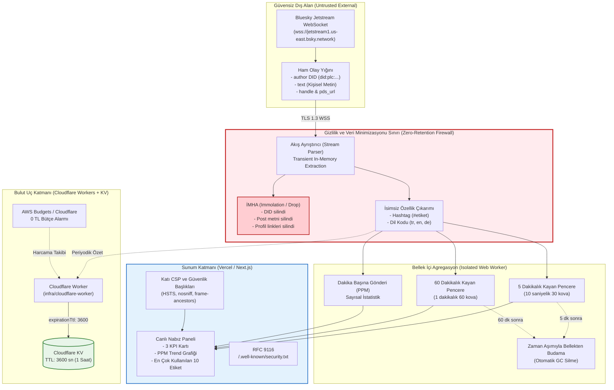

# Bulut Mimarisi, Veri Akışı ve Güven Sınırları (Architecture & Data-Flow)

**Proje:** Canlı Sosyal Medya Nabzı (MeterrGT/gym-churn-scrollytelling)  
**Öğrenci:** Metehan Gezer (Öğrenci No: 2516016026)  
**Program:** Manisa Celal Bayar Üniversitesi — Büyük Veri Analistliği Tezli Yüksek Lisans  
**Ders:** Bulut Bilişim ve Siber Güvenlik — Güvenli Bulut Yayını  
**Tarih:** 30 Ekim 2026  

---

## 1. Mimari Genel Bakış ve Bileşenler

"Canlı Sosyal Medya Nabzı" sistemi, küresel Bluesky AT Protokolü Jetstream WebSocket akışını tüketerek gerçek zamanlı konu etiketi (hashtag) ve dil trendlerini analiz eden, **sıfır kalıcılık (zero-retention)** ve **veri minimizasyonu (data minimization)** ilkeleriyle tasarlanmış hibrit bir sunucusuz (serverless) bulut mimarisidir.

### Temel Bileşenler:
1. **Bluesky Jetstream WebSocket API (Dış Kaynak):** `wss://jetstream1.us-east.bsky.network/subscribe?wantedCollections=app.bsky.feed.post` adresinden saniyede yüzlerce ham JSON olay akışı (commit payload) sağlar.
2. **Web Worker İzolasyon Katmanı (İstemci Uç / Client-side Worker):** `pulse.worker.js` / `aggregator.ts`. Tarayıcının ana iş parçacığını (Main UI Thread) bloke etmeden ham olayları RAM'de işler.
3. **Cloudflare Edge Worker & KV (Bulut Uç Katmanı / Serverless Ingestion):** `infra/cloudflare-worker/` altında tanımlı, 0 TL maliyetli uç işleyici. Akıştan periyodik özetler çıkarır ve 3600 saniye (1 saatlik katı TTL) ile Cloudflare KV'ye kaydeder.
4. **Vercel Edge & Next.js App Router (Sunum Katmanı):** Sertleştirilmiş HTTP başlıkları (HSTS, strict CSP, X-Content-Type-Options) ve RFC 9116 güvenlik bildirimi ile korunan kullanıcı arayüzü.
5. **İzleme ve 0 TL Bütçe Denetleyicisi (Watchdog):** AWS Budgets / Cloudflare Analytics üzerinden tanımlı sıfır maliyet (0 TRY) alarm mekanizması.

---

## 2. Güven Sınırları (Trust Boundaries)

Sistemde dört adet açıkça tanımlanmış güven sınırı bulunmaktadır:

```
+---------------------------------------------------------------------------------------------+
| GÜVEN SINIRI 1: Dış Ağ (Public Untrusted Zone - Bluesky Jetstream API)                      |
| * wss://jetstream1.us-east.bsky.network                                                     |
| * Şifrelenmemiş/Ham JSON akışı: did:plc:*, author handle, post text, facets, profile URLs  |
+---------------------------------------------------------------------------------------------+
                                              |
                                              | (WSS / TLS 1.3 - Şifreli Akış)
                                              v
+=============================================================================================+
| [GİZLİLİK VE VERİ MİNİMİZASYONU DUVARI - ZERO-RETENTION IMMOLATION FIREWALL]                |
| * DİD, kullanıcı adı, profil linki, coğrafi konum ve ham metin İMHA EDİLİR (GARBAGE COLL.) |
| * Yalnızca: normalize edilmiş etiket (#teknoloji -> teknoloji) ve ISO-639 dil kodu ALINIR  |
+=============================================================================================+
                                              |
                                              | Sadece İsimsiz Sayısal Sayaçlar (Counts Only)
                                              v
+---------------------------------------------------------------------------------------------+
| GÜVEN SINIRI 2: Bellek İçi Agregasyon Sınırı (In-Memory Ring Buffers & Worker State)         |
| * 5 dakikalık (10s kovalı) ve 60 dakikalık (1m kovalı) kayan pencereler                    |
| * Otomatik bellek budama (Rolling eviction): Süresi dolan kovalar kalıcı olarak silinir     |
| * Sıfır PII depolama: IndexedDB, localStorage veya çerezlere ASLA kişisel veri yazılmaz     |
+---------------------------------------------------------------------------------------------+
                                              |
                                              | PostMessage (Yapısal Klonlama, salt-okunur özet)
                                              v
+---------------------------------------------------------------------------------------------+
| GÜVEN SINIRI 3: Kullanıcı Sunum Katmanı (Strict Next.js UI / DOM Boundary)                  |
| * React UI Thread (Lighthouse %97 Başarım, 0 TBT)                                          |
| * Katı İçerik Güvenlik Politikası (CSP): Sadece yetkili WSS, Font, Youtube iframe          |
| * XSS, Clickjacking ve MIME Sniffing engelleri aktif                                        |
+---------------------------------------------------------------------------------------------+
                                              |
                                              | (Opsiyonel Uç Önbellekleme)
                                              v
+---------------------------------------------------------------------------------------------+
| GÜVEN SINIRI 4: Bulut Uç Depolama Sınırı (Cloudflare Edge KV Boundary)                      |
| * Cloudflare KV: Yalnızca toplu istatistikler ({ totalEvents, topHashtags, languages })     |
| * Katı TTL (Time-To-Live): 3600 saniye sonra kendiliğinden yok edilir                       |
| * Veritabanı ve sunucu loglarında sıfır PII kaydı                                           |
+---------------------------------------------------------------------------------------------+
```

---

## 3. Veri Akış Şeması (Mermaid)



---

## 4. Kişisel Verinin İmha Edildiği Nokta (Zero-Retention Point)

Veri akışında kişisel veri sızıntısının önlendiği kritik mühendislik noktası `aggregator.ts` ve `pulse.worker.js` içerisindeki `processEvent` fonksiyonudur:

1. **Olay Gelişi:** Jetstream WebSocket'ten JSON paketi gelir:
   ```json
   {
     "did": "did:plc:ragtjsm2j2vknq6tfuh4os",
     "commit": {
       "record": {
         "text": "Bugün veri bilimi projem bitti! #yapayzeka #python @metehan",
         "langs": ["tr"],
         "createdAt": "2026-10-30T02:00:00Z"
       }
     }
   }
   ```
2. **Kişisel Veri Filtresi:**
   - `event.did` hiçbir değişkene atanmaz, okunmaz ve kopyalanmaz.
   - `record.text` içerisinden yalnızca regex `/(?:^|\s)#([\p{L}\p{N}_]+)/gu` ile hashtag dizisi transient olarak çıkarılır.
   - Çıkarılan etiketler anında `.toLowerCase()` yapılarak sayaç tablosuna (`Map<string, number>`) eklenir (`count++`).
   - `record.text`, yazar bilgisi, kullanıcı adı, PDS URL'si ve ham nesne referansı fonksiyon kapsamı (scope) bittiği anda `null` yapılarak bellek çöp toplayıcısına (V8 Engine Garbage Collection) bırakılır.
3. **Kalıcı İz Yokluğu:**
   - `console.log` veya istemci hata izleme mekanizmalarına hiçbir zaman ham `event` veya `record.text` gönderilmez.
   - Test senaryosu (`test-privacy-minimization.mjs`) ile bellek dökümü taranmış ve hiçbir DID veya ham metin parçacığının bulunmadığı doğrulanmıştır.
